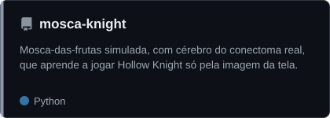
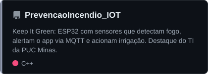
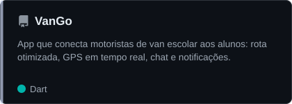
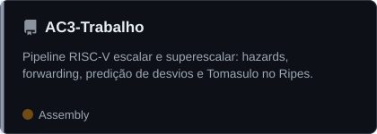

  

  
  

<h3 align="center">Quem sou eu?</h3>

<table align="center">
  <tr>
    <td width="30%" align="center"></td>
    <td>
      Sou estudante de <code>Engenharia de Computação</code> na <strong>PUC Minas</strong>. Gosto de construir sistemas que unem hardware e software: de sensores em um ESP32 a aplicativos mobile e modelos de aprendizado de máquina.
        
      Sou monitor de <code>Algoritmos e Estruturas de Dados</code> e de <code>Arquitetura de Computadores</code>.
        
      Fora do código, edito vídeos, imagens, música e podcasts como freelancer.
    </td>
  </tr>
</table>

<h3 align="center">⚔️ Um pouco mais sobre mim</h3>

  ◼ Fã de Hollow Knight, tanto que ensinei uma mosca-das-frutas simulada a jogar 
  ◼ Construindo o PRIME, meu sistema pessoal com um agente de IA para cada área da vida 
  ◼ Toco violão e treino na academia 
  ◼ Português (nativo) · Inglês (intermediário) · Francês (elementar)

  
  

<h3 align="center">📊 GitHub Status</h3>

  

<h3 align="center">🛠️ Minhas Stacks</h3>

  

<h3 align="center">🗂️ Meus Melhores Repositórios</h3>

  
  
  
  

  Também: o <strong>PRIME</strong> (React, TypeScript, Supabase, Kotlin e Claude API, privado) 
  e um <a href="https://github.com/IagoVRomeiro/Projeto_AEDS3">sistema de dados em arquivos</a> em Java, com Árvore B+, Hashing Estendido, Huffman/LZW e criptografia.

